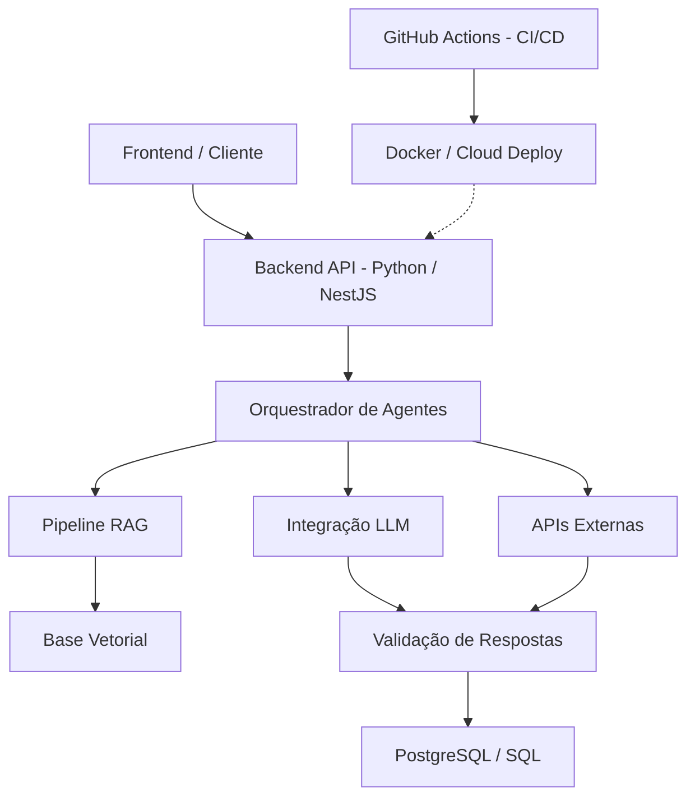

<h1 align="center">
  

## 🎓 Formação & Certificações

  

    

  

  

   

  

  

---
</h1>

  <b>Software Engineer | Backend Development | Python | AI Integration | Automation </b>

  
  
  
  
  
  

> Engenheira de Software focada no design de sistemas escaláveis, arquitetura de microsserviços, integração avançada de IA e automação de alta performance. Experiência consolidada em toda a stack — do desenvolvimento backend e frontend à infraestrutura, testes automatizados e observabilidade.

## 🧠 AI Engineering | Agentic AI, RAG & LLMs

> **Foco:** Orquestração de Agentes Autônomos, Sistemas RAG e Integração Determinística com LLMs.

- **Sistemas RAG Avançados:** Implementação de pipelines de recuperação contextual, busca vetorial e mitigação de alucinações.
- **Agentes Autônomos (Agentic AI):** Orquestração de workflows complexos baseados em agentes para automação inteligente de processos de negócio.
- **Engenharia de LLMs:** Integração de Large Language Models via API, engenharia de prompts estruturados, validação de contratos de dados e tratamento determinístico de respostas.

---

## 🏛️ Core Architecture & Backend Engineering

> **Stack Principal:** Python, NestJS, React, TypeScript, REST APIs e Microsserviços.

- **Design de Sistemas:** Concepção e evolução de arquiteturas backend robustas, desacopladas e orientadas a domínio.
- **Desenvolvimento Full-Stack:** Construção de aplicações web performáticas com React no frontend e APIs resilientes em NestJS e Python.
- **Persistência & Modelagem:** Estruturação avançada de bancos de dados relacionais (PostgreSQL, MySQL, SQL Server) com ORMs (SQLAlchemy) e otimização de consultas complexas.

---

## ⚙️ DevOps, Versionamento, CI/CD & Deploy

> **Ferramentas:** Git, GitHub, GitHub Actions, Docker, Linux, Render, Vercel, n8n.

- **Controle de Versão:** Gestão avançada de branches, pull requests e governança de código com Git/GitHub.
- **Pipelines CI/CD:** Automação contínua de builds, testes e deploys utilizando GitHub Actions.
- **Containerização & Deploy:** Empacotamento de serviços com Docker, configuração de variáveis de ambiente e gerenciamento de deploys em infraestruturas Linux e Cloud.
- **Orquestração de Automações:** Integrações de sistemas e fluxos corporativos automatizados.

---

## 📊 Data Engineering & Business Intelligence

> **Ferramentas:** Pandas, NumPy, Power BI, DAX, Power Query, SQL.

- **Pipelines ETL:** Desenvolvimento de rotinas robustas para extração, limpeza, transformação e carga de dados.
- **Business Intelligence:** Modelagem analítica, DAX avançado e criação de dashboards executivos para suporte à tomada de decisão.

---

## 🚀 Arquitetura de Referência

---
  

## 📫 Contato

  

  

  

---
